<div align="center">

<picture>
  <source media="(prefers-color-scheme: dark)" srcset="docs/assets/banner-dark.svg">
  <source media="(prefers-color-scheme: light)" srcset="docs/assets/banner-light.svg">
  
</picture>

<br><br>

[](https://github.com/Ramssmb/Ram-s-smb-personal-digital-universe-/actions/workflows/ci.yml)


**[Overview](#-overview)** ·
**[Screenshots](#-screenshots)** ·
**[Architecture](#-architecture)** ·
**[Security](#-security-model)** ·
**[Quality](#-quality-gates)** ·
**[Run it](#-run-it-locally)** ·
**[Docs](#-documentation)**

</div>

```console
$ curl -s https://<domain>/api/v1/health      # not deployed yet — local build shown
{"status":"ok"}

$ cat SYSTEM_STATUS
version ........... 0.4.0 (last verified commit 42c5d2c — CI 5/5 jobs green)
runtime ........... Node.js 24 · Next.js 16 App Router · React 19 · TypeScript (strict)
database .......... PostgreSQL 17 · Drizzle ORM · 30 tables · 29 foreign keys · 3 migrations
surface ........... 26 pages · 21 API route files · 12 content collections
codebase .......... 143 source files (14,066 lines) · 28 test files (3,852 lines)
tests ............. unit 133 · integration 137 · end-to-end 90 · functional audit 180/180
security .......... Argon2id · TOTP 2FA · nonce CSP · CSRF origin check · least-privilege DB role
deployment ........ Docker Compose + Caddy (auto-HTTPS) · backup + restore verified in CI
status ............ ready to deploy · not yet public · content not yet entered
```

## ◆ Overview

A personal website and its private content-management dashboard, built and
operated as one self-hosted system. Everything on the public site is a database
record the owner manages at `/admin` — no code changes to publish, and **nothing
appears until it is explicitly published**.

| Public site                                                      | Private dashboard (`/admin`)                                                      |
| ---------------------------------------------------------------- | --------------------------------------------------------------------------------- |
| Home, about, education, skills, projects + detail pages          | Create · preview · publish · unpublish · archive · delete for every content type  |
| Experience, achievements and certifications                      | Featured flags, private visibility, manual ordering, optimistic-concurrency saves |
| Dated learning journal with monthly archive and RSS              | Media library: upload, re-encode, replace, private files, in-use protection       |
| Resources, links, contact form, full-text search                 | Contact inbox, categories, tags, site settings and per-page SEO                   |
| Light/dark themes, phone → desktop, WCAG 2.2 AA checked with axe | Two-factor sign-in, session revocation, sign-in activity, audit log               |

> **Honest by design.** The starter data contains only structure and facts the
> owner confirmed. Unknown details stay empty and unpublished until entered.

## ◆ Screenshots

### Ram's Dev Space — public site

<table>
  <tr>
    <td width="50%">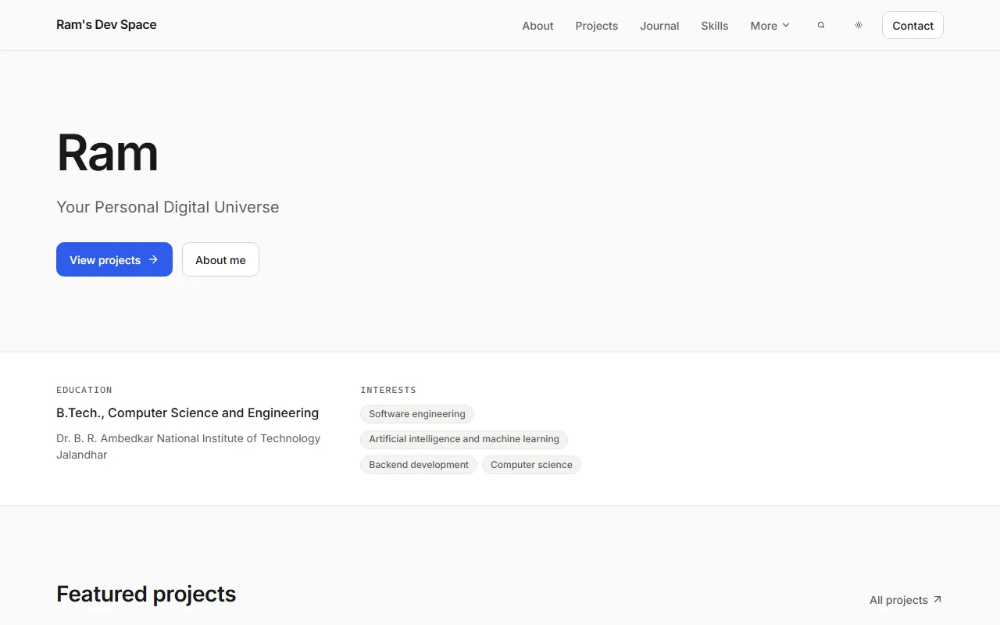</td>
    <td width="50%">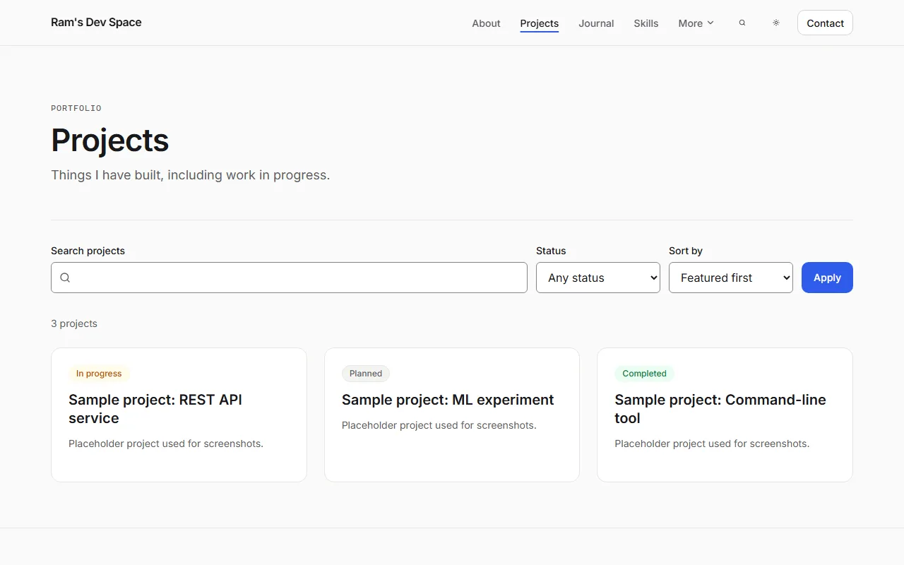</td>
  </tr>
  <tr>
    <td align="center"><sub><b>Home</b> — name, tagline, education and interests</sub></td>
    <td align="center"><sub><b>Projects</b> — search, status filter and sorting</sub></td>
  </tr>
  <tr>
    <td width="50%">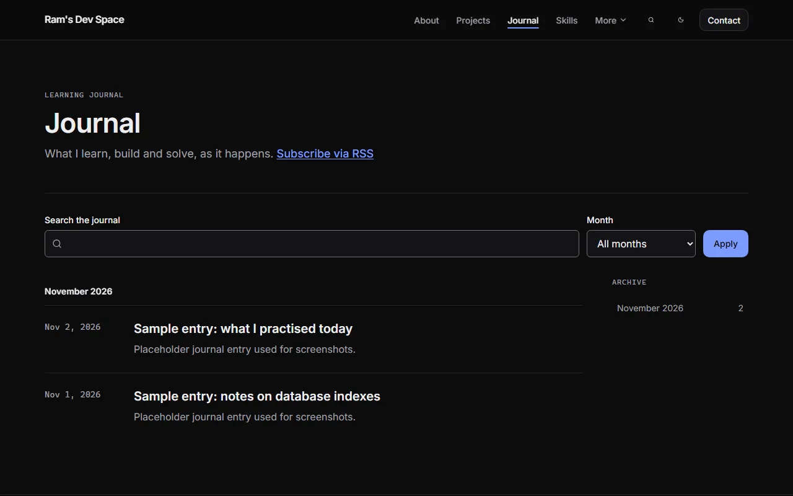</td>
    <td width="50%">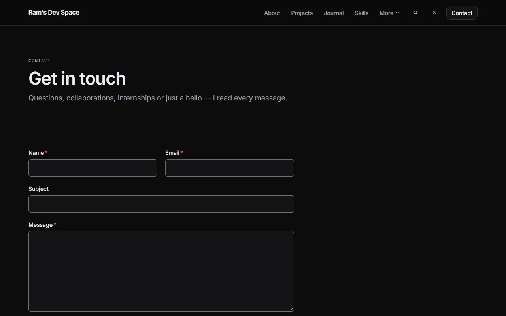</td>
  </tr>
  <tr>
    <td align="center"><sub><b>Journal</b> — dated entries, monthly archive, RSS</sub></td>
    <td align="center"><sub><b>Contact</b> — validated form, spam protection, private inbox</sub></td>
  </tr>
</table>

<sub>Brand, name, tagline, education and interests are confirmed by the owner.
Projects and journal entries in these four screenshots are labelled
placeholders, not real work.</sub>

### Private dashboard

<table>
  <tr>
    <td width="50%">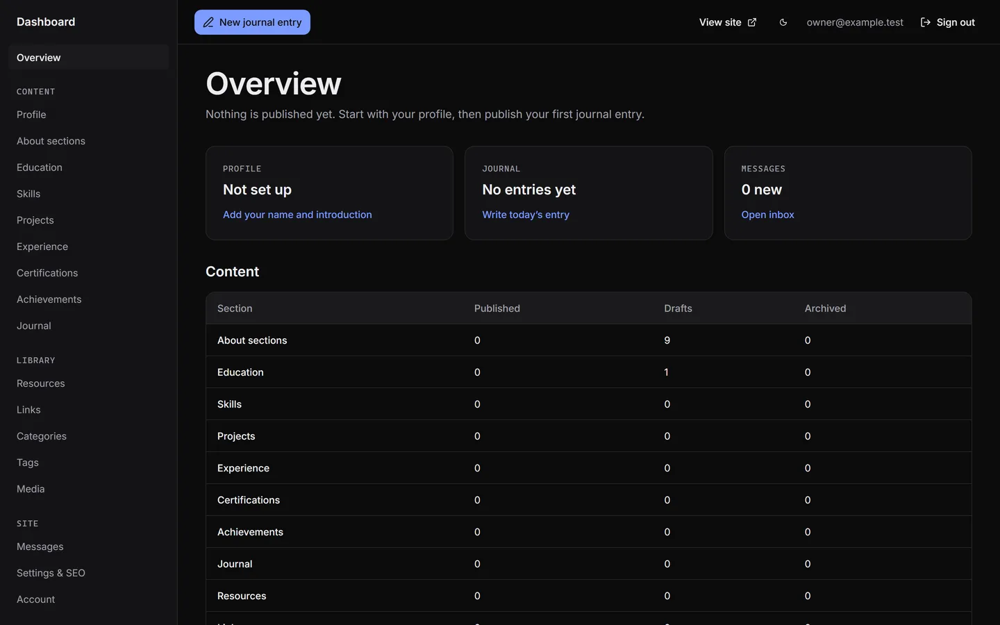</td>
    <td width="50%">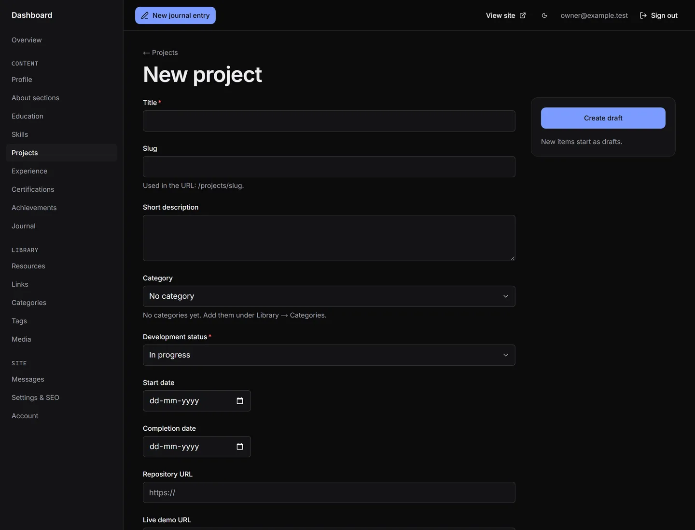</td>
  </tr>
  <tr>
    <td align="center"><sub><b>Overview</b> — live counts per section, read straight from PostgreSQL</sub></td>
    <td align="center"><sub><b>Editor</b> — one schema drives the form, the API validation and the database writes</sub></td>
  </tr>
  <tr>
    <td width="50%">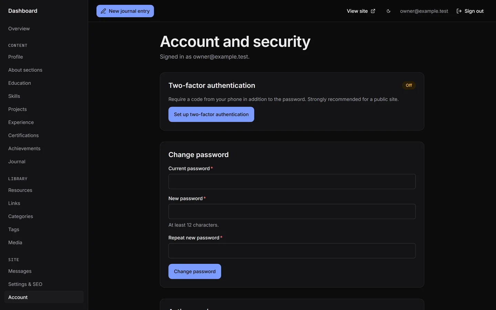</td>
    <td width="50%">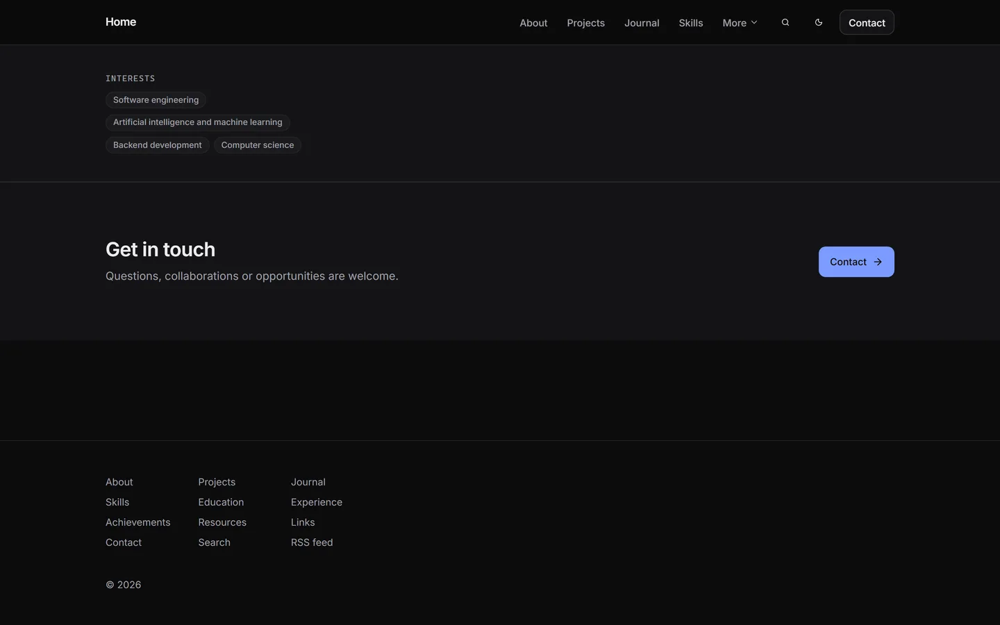</td>
  </tr>
  <tr>
    <td align="center"><sub><b>Account</b> — TOTP two-factor, password change, active sessions</sub></td>
    <td align="center"><sub><b>Public home</b> — before any content is published</sub></td>
  </tr>
</table>

<p align="center">
  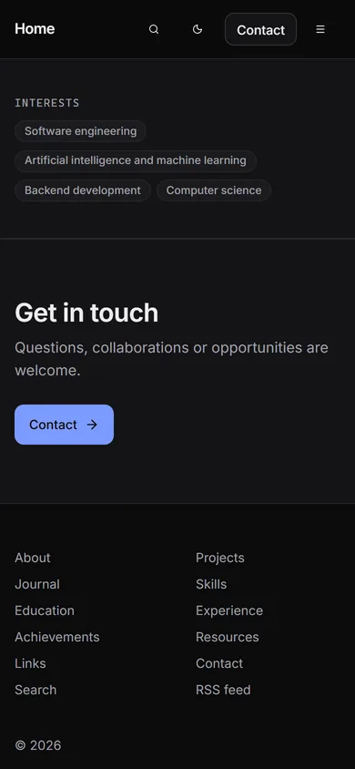
  &nbsp;&nbsp;&nbsp;
  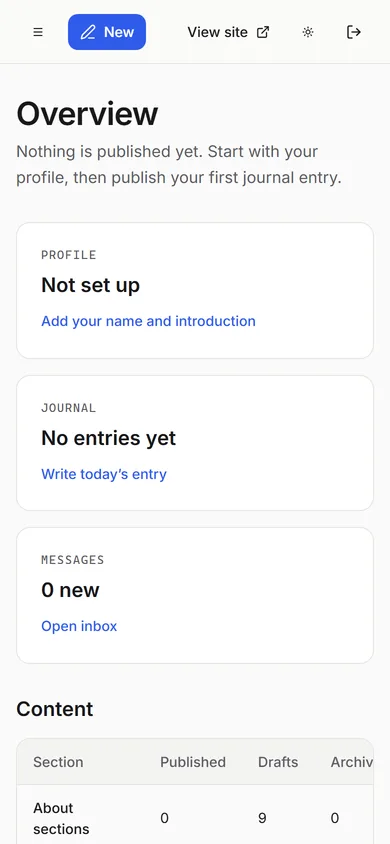
  <br><sub>Phone layouts — public site (dark) and dashboard (light)</sub>
</p>

<sub>Dashboard screenshots are of the real application running locally with an
empty content database; no sample personal data is shown.</sub>

## ◆ Architecture

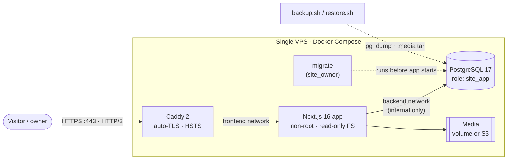

<details>
<summary><b>Request lifecycle</b> — what happens on an admin write</summary>

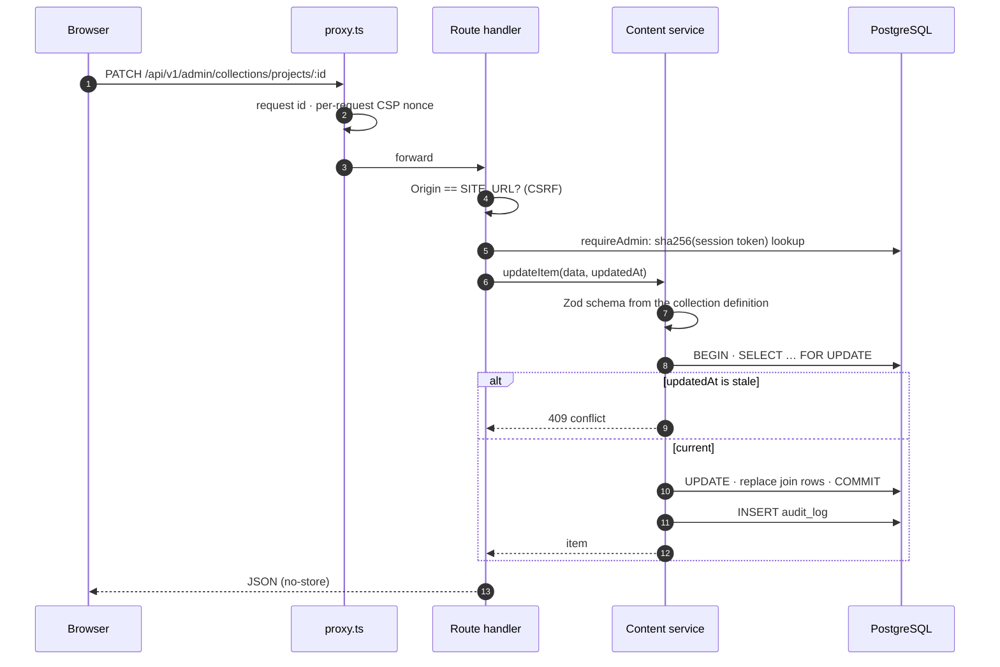

</details>

<details>
<summary><b>Content lifecycle</b> — the publishing state machine</summary>

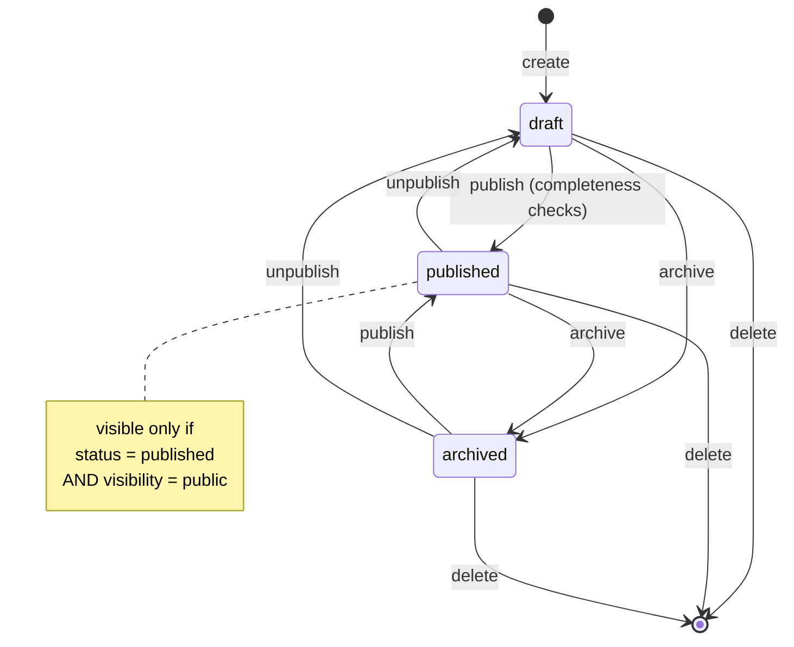

</details>

<details>
<summary><b>Data model</b> — core relations (30 tables, 29 foreign keys)</summary>

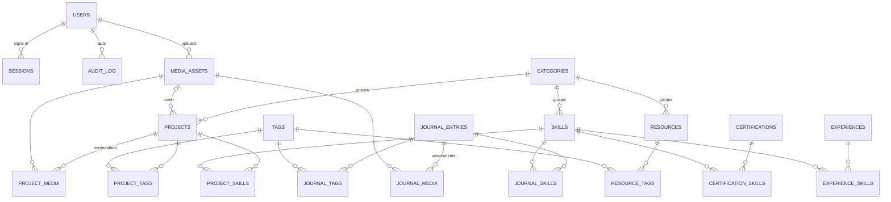

</details>

Design decisions and trade-offs: [ARCHITECTURE.md](ARCHITECTURE.md) ·
schema: [docs/DATABASE_DESIGN.md](docs/DATABASE_DESIGN.md) ·
API: [docs/API_DESIGN.md](docs/API_DESIGN.md).

## ◆ Security model

| Layer         | Control                                                                                                       |
| ------------- | ------------------------------------------------------------------------------------------------------------- |
| Identity      | Argon2id password hashes · optional RFC 6238 TOTP with hashed single-use recovery codes and replay guard      |
| Sessions      | 256-bit random tokens, only `sha256(token)` stored · `__Host-` cookie, `HttpOnly`, `SameSite=Lax` · revocable |
| Requests      | `Origin` check on every write (CSRF) · per-request **nonce CSP** · HSTS · `X-Frame-Options: DENY`             |
| Authorization | `requireAdmin` at the top of every admin handler and page — a test enumerates all routes from disk            |
| Data          | App runs as `site_app` (rows only); migrations as `site_owner` · parameterized queries only                   |
| Uploads       | Magic-byte sniffing · images re-encoded by sharp (EXIF/GPS stripped) · SVG/HTML refused · private bucket path |
| Abuse         | Postgres-backed rate limits (login, 2FA, contact, search, uploads) · contact honeypot + signed timing token   |
| Logs          | Structured JSON with request ids · passwords, cookies, tokens, message bodies and SQL parameters redacted     |

Full threat model: [docs/AUTH_AND_SECURITY.md](docs/AUTH_AND_SECURITY.md).

## ◆ Quality gates

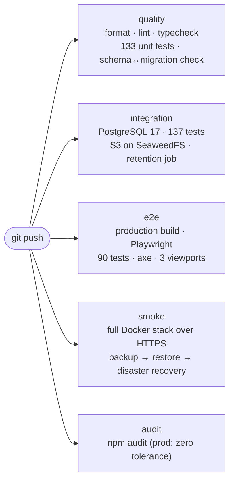

| Measure                                  | Result                                                                                                |
| ---------------------------------------- | ----------------------------------------------------------------------------------------------------- |
| Functional audit (live app + real DB)    | **180 / 180** HTTP + database checks · **90 / 90** browser tests — [report](docs/FUNCTIONAL_AUDIT.md) |
| Media disaster recovery (CI, every push) | Every stored file deleted, restored, **SHA-256 identical**                                            |
| Lighthouse, mobile, simulated slow 4G    | Performance **96–100** · Accessibility **100** · Best practices **100** · SEO **100**¹                |
| Layout shift (CLS)                       | **0** on every measured page                                                                          |

<sub>¹ Measured locally on the production build (Lighthouse 13.6). Text pages
score 100 (LCP ≈ 0.64 s); image-led pages 96–97 (simulated LCP 2.7–2.8 s).
Details in [PROJECT_PROGRESS.md](PROJECT_PROGRESS.md).</sub>

## ◆ Run it locally

Requirements: **Node.js 24+** and **PostgreSQL 17**. The easiest way to get
PostgreSQL is Docker Desktop (on Windows Home it needs WSL 2:
`wsl --install` in an administrator terminal, then restart).

```bash
cp .env.example .env
# Set APP_SECRET in .env:
node -e "console.log(require('crypto').randomBytes(32).toString('base64url'))"

docker compose up -d db       # PostgreSQL 17 on 127.0.0.1:5433 with dev/test/e2e databases
npm install
npm run db:migrate            # create the schema
npm run db:seed               # categories, empty draft sections, verified facts
npm run admin:create          # your owner account (prompts for email and password)
npm run dev                   # http://localhost:3000  — dashboard at /admin
```

<details>
<summary><b>All commands</b></summary>

| Command                    | What it does                                                    |
| -------------------------- | --------------------------------------------------------------- |
| `npm run dev`              | Development server                                              |
| `npm run build`            | Production build (needs no database)                            |
| `npm run lint`             | ESLint                                                          |
| `npm run typecheck`        | TypeScript (strict)                                             |
| `npm run format`           | Prettier                                                        |
| `npm test`                 | Unit tests                                                      |
| `npm run test:integration` | Integration tests against `personal_site_test`                  |
| `npm run test:e2e`         | Playwright against the production build and `personal_site_e2e` |
| `npm run db:generate`      | Create a migration after changing `src/server/db/schema`        |
| `npm run db:migrate`       | Apply migrations                                                |
| `npm run db:seed`          | Seed structure (safe to repeat)                                 |
| `npm run admin:create`     | Create the owner account or reset its password                  |
| `npm run maintenance`      | Prune expired sessions, rate limits, old audit entries and spam |

First-time end-to-end setup: `npx playwright install chromium`.

</details>

Production deployment (Docker Compose + Caddy on one server):
[docs/DEPLOYMENT.md](docs/DEPLOYMENT.md) ·
before you buy anything: [docs/DEPLOYMENT_PREPARATION.md](docs/DEPLOYMENT_PREPARATION.md).

## ◆ Project layout

```
src/
├── app/
│   ├── (site)/            public pages — server components, per-request render
│   ├── admin/             dashboard: login, content, media, messages, settings, account
│   └── api/v1/            REST API — auth · admin · contact · health
├── components/            ui/ design system · site/ chrome · public/ · admin/
├── lib/content/           collection definitions → forms + Zod validation + DB columns
└── server/                server-only: auth · db (Drizzle) · content · media · security
drizzle/                   reviewed SQL migrations
infra/                     postgres roles · Caddyfile · backup/restore · prod smoke test
tests/                     unit/ · integration/ · e2e/
docs/                      design, API, security, deployment, audit
```

## ◆ Documentation

| Document                                                         | Contents                                      |
| ---------------------------------------------------------------- | --------------------------------------------- |
| [ARCHITECTURE.md](ARCHITECTURE.md)                               | System design and decisions                   |
| [docs/DATABASE_DESIGN.md](docs/DATABASE_DESIGN.md)               | Schema                                        |
| [docs/API_DESIGN.md](docs/API_DESIGN.md)                         | REST API                                      |
| [docs/AUTH_AND_SECURITY.md](docs/AUTH_AND_SECURITY.md)           | Authentication and security controls          |
| [docs/DESIGN_SYSTEM.md](docs/DESIGN_SYSTEM.md)                   | Visual and interaction design                 |
| [docs/DEPLOYMENT.md](docs/DEPLOYMENT.md)                         | Production deployment, backups, rollback      |
| [docs/DEPLOYMENT_PREPARATION.md](docs/DEPLOYMENT_PREPARATION.md) | Before deploying: costs, decisions, checklist |
| [docs/DEPLOYMENT_VERCEL.md](docs/DEPLOYMENT_VERCEL.md)           | Vercel + Neon set-up, backups, restore        |
| [docs/VERCEL_ARCHITECTURE.md](docs/VERCEL_ARCHITECTURE.md)       | Vercel research, architecture, decisions      |
| [docs/CONTENT_GUIDE.md](docs/CONTENT_GUIDE.md)                   | What to enter in the dashboard                |
| [docs/FUNCTIONAL_AUDIT.md](docs/FUNCTIONAL_AUDIT.md)             | Functional audit of the running app (v0.4.0)  |
| [docs/ACCESSIBILITY_TESTING.md](docs/ACCESSIBILITY_TESTING.md)   | NVDA test guide; browser and Windows checks   |
| [docs/ROADMAP.md](docs/ROADMAP.md)                               | Phases and exit criteria                      |
| [PROJECT_PROGRESS.md](PROJECT_PROGRESS.md)                       | Status, measurements, known limitations       |
| [CHANGELOG.md](CHANGELOG.md)                                     | Release notes                                 |
| [CONTRIBUTING.md](CONTRIBUTING.md)                               | Workflow and rules                            |

<div align="center">
<br>
<sub>Built with care for correctness · nothing published that isn't true</sub>
</div>
